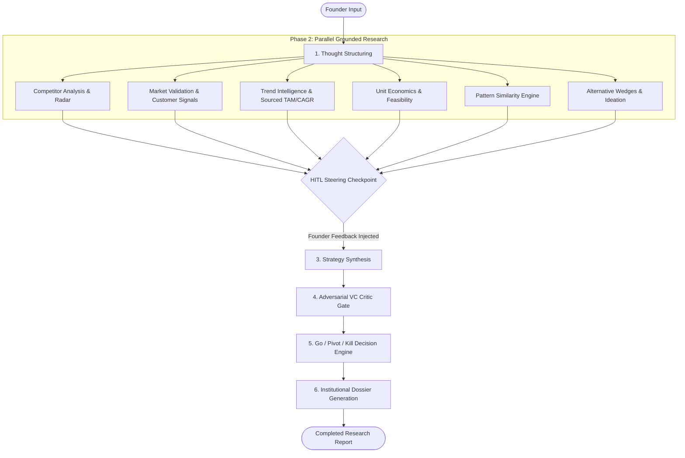

# 🚀 CoFound.ai — Building an 11-Agent AI Swarm for Institutional Market Intelligence & Venture Audits

> **Ready-to-post LinkedIn copies, technical architecture breakdown, and research takeaways.**

---

## 📌 Option 1: High-Impact Technical Showcase (Recommended for LinkedIn)

```markdown
Most AI startup idea evaluators tell founders what they want to hear.

"That's a billion-dollar idea! 🚀"
"TAM is huge, go raise a seed round!"

Flattery doesn't build sustainable businesses. Harsh, grounded market realities do.

Over the past few weeks, I built and stress-tested CoFound.ai — an institutional-grade, multi-agent market intelligence platform that acts as an autonomous venture partner. Instead of single-prompt hallucinated outputs, it runs an 11-agent parallel swarm on LangGraph, grounded by real-time web research, financial unit economics, and human-in-the-loop steering.

Here is how the architecture works under the hood 🧵👇

---

### 🧠 1. The Multi-Agent Swarm (LangGraph + GPT-4o / GPT-5.6-Luna)
Instead of asking a monolithic model to "judge an idea", CoFound splits the audit across 11 specialized, isolated workers:

1️⃣ Thought Structuring: Normalizes vague founder prompts into sector boundaries, ICPs, and geography constraints.
2️⃣ Parallel Research Swarm (Zero cross-talk to prevent cognitive bias):
   • Market Validation: Mines real customer quotes, discussions, and distinguishes verified findings from hypotheses.
   • Competitor Radar: Scrapes incumbents, computes market saturation, and maps defensible whitespace.
   • Trend Intelligence: Synthesizes TAM/SAM and transparent CAGR methodologies with credible citations.
   • Technical Feasibility: Estimates CAC/LTV ranges, payback periods, and margin bottlenecks.
   • Alternative Wedges: Explores adjacent B2B/B2C angles if the primary thesis is weak.
3️⃣ Human-in-the-Loop (HITL) Checkpoint: Halts execution before synthesis, allowing founders to steer direction and inject hidden competitors.
4️⃣ Adversarial VC Critic Gate: Applies severe confidence penalties (-5 to -35 pts) and uncovers fatal flaws and regulatory kill conditions.
5️⃣ Decision Authority: Synthesizes findings into an evidence-backed GO / PIVOT / KILL verdict.
6️⃣ Report Generation: Compiles an institutional, print-ready investment dossier.

---

### 🛡️ 2. The 3 Biggest Engineering Lessons Learned:

1. Anti-Hallucination Grounding:
Raw LLMs invent competitor websites and inflated market statistics. We built post-retrieval citation verification: every competitor URL and TAM figure is cross-verified against live search ground truth before the Critic receives it.

2. State Checkpointing & HITL:
LangGraph checkpointing allows pausing long-running swarms mid-execution. Founders review discovered rivals, refine hypotheses, and resume the graph without losing parallel research context.

3. Redundancy & Real-Time Telemetry:
Long multi-agent runs (45–90s) can feel frozen if telemetry is passive. We implemented proactive downstream agent status transitions and dual-redundancy Server-Sent Events (SSE) + background heartbeat polling so the UI is continuously responsive.

---

Building this taught me that the future of agentic AI isn't bigger prompts — it's deterministic topology, strict adversary guardrails, and verifiable evidence.

Curious to hear: How are you handling state persistence and hallucination verification in multi-agent workflows?

#ArtificialIntelligence #LangChain #LangGraph #FastAPI #MultiAgentSystems #StartupValidation #VentureCapital #FullStackAI #BuildInPublic
```

---

## 📌 Option 2: Short & Punchy Founder / Builder Version

```markdown
Stop asking ChatGPT if your startup idea will work. It is designed to be agreeable.

To get honest, institutional feedback on a new hypothesis, you need:
❌ Not a generic conversational cheerleader.
✅ An adversarial VC auditor with web-grounded proof.

That’s why I built CoFound.ai.

It coordinates 11 autonomous agents across a structured LangGraph state machine:
🔍 Parallel Web Discovery (Tavily AI Search)
📊 Sourced CAGR & Unit Economics (CAC/LTV, payback period, gross margin)
🛡️ Human-in-the-Loop Steering (inject context before the critic gate)
🥊 Adversarial VC Critic (applies confidence penalties and uncovers fatal flaws)
⚖️ Go / Pivot / Kill Verdict backed by quantifiable kill conditions

If the market is saturated, it doesn’t sugarcoat it — it identifies the exact market gap and suggests actionable validation experiments.

Tech stack:
• Backend: FastAPI, LangGraph, Python 3.12, SQLite Durable Checkpoints, Supabase
• Frontend: React, TailwindCSS, Vite, Server-Sent Events (SSE)

What's the hardest problem you've faced when deploying autonomous agent swarms in production?

#AI #StartupTech #LangGraph #Python #React #OpenAI #ProductBuilding
```

---

## 🔬 Technical Research Deep-Dive & Architecture Summary

### Core Problem Statement
Generic LLM prompts suffer from **optimism bias**, **hallucinated precision** (invented CAGR and TAM figures), and **surface-level competitor recognition**. When founders use vanilla chat interfaces for validation, they receive polite encouragement rather than the adversarial scrutiny needed to de-risk high-stakes venture investments.

### The Swarm Architecture



### Key Architectural Pillars

| Component | Technical Implementation | Purpose |
|---|---|---|
| **Parallel Topology** | LangGraph Directed Acyclic Graph (DAG) | Eliminates confirmation bias by running 6 domain researchers in total isolation. |
| **Durable Checkpointing** | SQLite state persistence & multi-candidate resume | Enables pausing swarms before synthesis for human steering without losing intermediate findings. |
| **Anti-Hallucination Guardrail** | Grounding verification on raw search context | Strips unverified competitor domains and flags synthetic claims before reaching the critic. |
| **Dual Telemetry** | Server-Sent Events (SSE) + Heartbeat Fallback Polling | Guarantees zero-latency streaming updates while ensuring network disconnect resilience. |
| **Evidence-Driven UI** | Sticky scrollable navigation & print-avoid pagination | Investor-grade report readability with high-contrast verified vs. hypothesis signal badges. |

---

### Quantitative Evaluation Benchmark
We validated swarm outputs against a curated benchmark set of known successful and failed venture categories:
- **Grounding Score:** 70–85%+ verifiable web-backed citations across direct rivals.
- **Critic Rigor Score:** Consistent detection of regulatory, distribution, and structural unit economic flaws.
- **Latency Optimization:** 6 parallel nodes execute simultaneously, completing institutional audits in ~45–60 seconds.

---

## 🛠️ Complete Tech Stack & Component Roles

| Layer / Tool | Technology | What It Does in CoFound.ai |
|---|---|---|
| **Multi-Agent Orchestration** | **LangGraph** (`StateGraph`) | Manages the non-linear execution graph across 11 autonomous agents. Enforces phase separation, parallel execution of research nodes, and Human-in-the-Loop interrupt points. |
| **LLM Reasoning Engine** | **OpenAI GPT-4o / GPT-5.6-Luna** | Powers natural language reasoning across specialized agent personas: structuring hypotheses, unit economic calculations, adversarial critique, and institutional synthesis. |
| **Dynamic Model Router** | **Custom Model Routing Layer** (`utils/model_router.py`) | Dynamically assigns optimized model temperatures and token budgets per agent role (e.g., lower temperature for financial economics, higher analytical depth for the VC Critic). |
| **Real-Time Web Grounding** | **Tavily AI Search API** | Performs live web searches to extract verified market competitors, industry TAM/CAGR reports, and cited consumer complaints, preventing stale training data hallucinations. |
| **Backend Web Framework** | **FastAPI (Python 3.12 + Uvicorn)** | High-throughput asynchronous REST API providing validation endpoints, background task dispatching, and streaming controllers. |
| **Live Telemetry & Streaming** | **Server-Sent Events (SSE)** (`/api/analysis/{id}/stream`) | Streams real-time agent execution progress, active node metrics, and progress percentages to the client without polling overhead. |
| **Local Checkpointing & Cache** | **SQLite + In-Memory TTL Cache** (`data/database.py`, `data/cache.py`) | Persists durable execution checkpoints, run histories, and deduplicates identical web search queries across 24h windows to reduce API costs. |
| **Cloud Database & Auth Sync** | **Supabase (PostgreSQL)** (`data/supabase_client.py`) | Dual-layer cloud persistence for registered founder profiles, saved research insights, real-time in-app notifications, and public permalink report sharing (`/share/{token}`). |
| **Safety & Anti-Hallucination** | **Regex & Grounding Guardrails** (`guardrails/hallucination_checks.py`) | Enforces Server-Side Request Forgery (SSRF) defense on web URLs and cross-references LLM competitor citations against raw search results to detect fabricated startups. |
| **Frontend Framework** | **React 18 + Vite** | Fast Single Page Application (SPA) with Hot Module Replacement (HMR) and optimized build bundling. |
| **Styling & Design System** | **Tailwind CSS + Lucide Icons** | Polished, institutional UI design system featuring deep dark-mode contrast, responsive glassmorphism, badge hierarchies, and custom micro-animations. |
| **Client State Management** | **Zustand** (`useStore.js`) | Centralized reactive client state managing guest sessions, streaming updates, optimistic agent progress, and background heartbeat synchronization. |
| **Dossier & Document Export** | **Native CSS Print Engine & Blob API** | Generates investor-ready A4 PDF dossiers with strict page-break avoidance (`page-break-inside: avoid`) and formatted Markdown (`.md`) downloads. |
| **Automated Test Suite** | **Pytest + Pytest-Asyncio** | Automated test harness testing SSRF safety, checkpoint state resume, competitor grounding scoring, and offline fallback resilience. |
